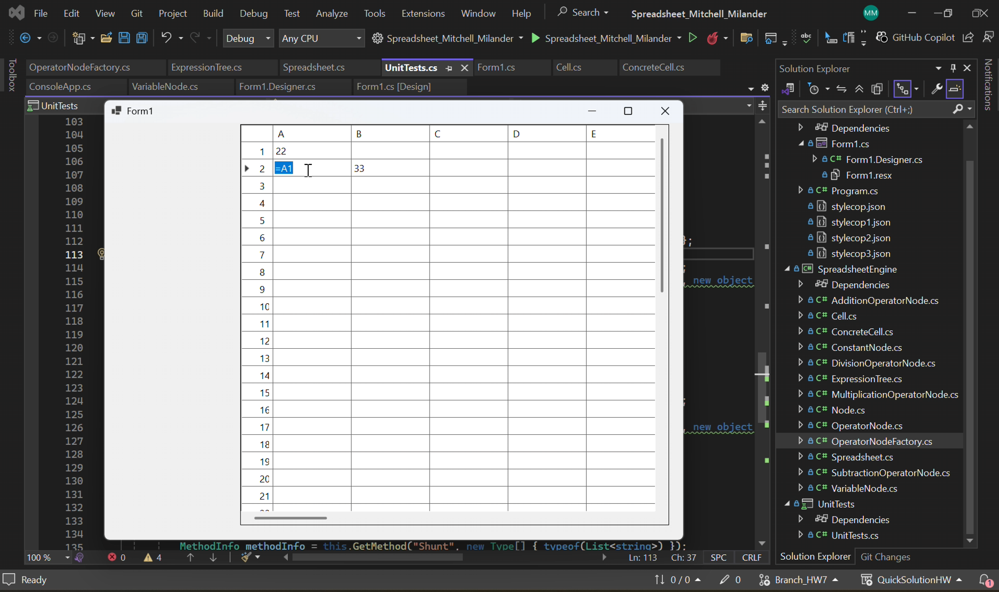

# Spreadsheet Application

A desktop spreadsheet application built in **C# with .NET 8 and Windows Forms** for a semester-long software engineering course at Washington State University. Through this project, I gained hands-on experience with object-oriented programming, expression parsing, event-driven programming, and software design patterns while building a spreadsheet application with separate logic and user interface components.

## Application screenshot

## Project highlights

- **Windows Forms spreadsheet UI:** Created a `DataGridView` with 26 columns (A–Z) and 50 rows, displaying cell text while editing and calculated values otherwise.
- **Arithmetic expression evaluator:** Built an expression-tree representation with constant, variable, and operator nodes, using tokenization and the **shunting-yard algorithm** to handle operator precedence and parentheses.
- **Reflection-based factory:** Created an `OperatorNodeFactory` that uses C# reflection and `Activator.CreateInstance` to discover and instantiate arithmetic operator nodes.
- **Event-driven updates:** Used `INotifyPropertyChanged` and cell-change events to propagate changes from the spreadsheet engine to the UI.
- **Command-based undo/redo:** Defined an `ICommand` interface and concrete commands for text and background-color changes, with stack-based undo/redo operations.
- **XML persistence:** Added `Save(Stream)` and `Load(Stream)` methods using .NET XML APIs to store and restore cell data.
- **Automated tests:** Wrote NUnit test cases for expression evaluation, cell behavior, editing commands, persistence, and reference handling.

## Software Design Patterns and Principles
| Concept | How I Applied It |
|---|---|
| **Polymorphism (GRASP)** | Used an abstract `Node` class with overridden `Evaluate()` methods to handle different arithmetic operations. |
| **Factory Pattern** | Used `OperatorNodeFactory` with C# reflection to dynamically create operator nodes without hardcoding each operator into the expression parser. |
| **Observer Pattern** | Used C# property-change events to notify the spreadsheet engine and user interface when cell properties changed. |
| **Command Pattern** | Created an `ICommand` interface and concrete commands to support undoing and redoing spreadsheet changes. |
| **Creator (GRASP)** | Used the `Spreadsheet` class to create and manage spreadsheet cells. |
| **Layered Architecture** | Separated the spreadsheet engine from the Windows Forms interface to keep application logic independent of the GUI. |
| **Pure Fabrication (GRASP)** | Created a separate `OperatorNodeFactory` class to handle operator creation, keeping that responsibility out of the `ExpressionTree` class and improving separation of concerns. |

**Technologies:** C#, .NET 8, Windows Forms, NUnit, XML, Visual Studio, Git.

## Running the application in Visual Studio

**Requirements:** Windows, Visual Studio with the **.NET desktop development** workload, and the **.NET 8 SDK**.

1. Clone or download this repository.
2. Open `HW10_Spreadsheet_Mitchell_Milander/Spreadsheet_Mitchell_Milander.sln` in **Visual Studio**.
3. In **Solution Explorer**, right-click the `Spreadsheet_Mitchell_Milander` application project and select **Set as Startup Project**.
4. Click the green **Start** button or press **F5** to build and launch the application.

### Unit tests

The `UnitTests` project uses **NUnit**. To explore or run its tests, open **Test → Test Explorer** in Visual Studio and run the available tests.
